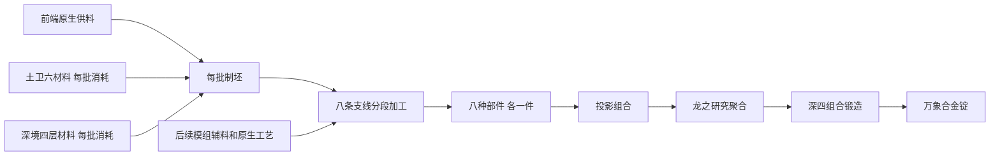

# 万象合金合成路线设计

第四版：按要求累计取消 28 个流程，保留其余步骤编号便于对照。以阶段五的土卫六和深境四层材料起步，制造八种具有不同用途的部件。原生供料设施先准备普通辅料；每批消耗新的阶段五材料制坯，逐段加工并加入模组材料，八种部件最终通过投影、聚合和组合锻造制成一锭万象合金。

优先复用合适的原生配方。无尽之尘、盆景原木、蜂蜡、玄武岩、胶乳和氦气均可直接使用既有产物；新的配方主要负责复合坯料、工艺衔接和部件装配。原生设备不会免费产出已经含有阶段五材料的高级中间件。

共规划 141 个工艺位置：7 个前端原生供料位置，134 个加工与最终合成位置。涉及 133 个配方标识和 7 类代码驱动操作，加入制坯与装配后共 179 个节点。供料原料有替代来源时，相应设备属于推荐路径；其余工艺也需完成接口与来源验收后才能宣称运行时强制覆盖。

本文是路线设计依据；实装与验证状态另见 [omni-alloy-implementation.json](omni-alloy-implementation.json)。以下物耗以一锭为单位；流体、原生载体和世界内操作保留各自的实际接口。

## 八种部件与阶段五入口

| 部件 | 在合金制造中的用途 | 每批消耗的阶段五材料 | 后续加入的模组材料 |
|---|---|---|---|
| 星浆仿生隔膜 | 隔离活性星浆，同时允许反应物定向交换。 | 氮质体膜片 ×2、多磷腈辅酶 ×1、星浆 ×1 | 豆浆、盐卤、谷物、蜂蜜、木质纤维 |
| 苍穹晶格透镜 | 折射并校准来自不同维度的投影。 | 冰晶合金锭 ×2、星浆晶胚 ×1、星浆晶体 ×1 | 天境石材、极寒载液、光晶、孢子 |
| 虹移共振腔 | 将魔力和虹移效应锁定在同一谐振空间。 | 风暴氢晶 ×1、虹移之熵 ×1、星浆晶体 ×1 | 活木、魔力、花瓣、符文、宝石 |
| 冰晶相变壳体 | 承受高温聚合并缓冲骤冷造成的体积变化。 | 冰晶合金锭 ×2、星浆晶胚 ×1 | 铁、煤、铜、木材、热解油、树脂 |
| 星门耦合线圈 | 在门瑞欧网络、灵魂介质和星门晶体之间传递能量。 | 精密电子元件 ×2、冰晶合金锭 ×1、虹移之熵 ×1 | 门瑞欧、耀魂、合金、太空金属、水晶 |
| 氢压逻辑阀组 | 同步气压、流量与 AE 控制信号。 | 精密电子元件 ×1、风暴氢晶 ×1、星浆晶胚 ×1 | 压缩铁、塑料、红石、赛特斯、石英 |
| 中子约束环 | 约束粒子束并稳定聚合时的同位素结构。 | 冰晶合金锭 ×2、ε 尘 ×1、星浆晶胚 ×1 | 专用矿料、酸碱、水、核燃料、受控粒子束 |
| 万象校准光栅 | 保存多重光学标定与刻线基准，控制最终合金成形。 | 精密电子元件 ×2、硅晶粉 ×2、星浆晶体 ×1 | 耀魂、刀卷、刻线刀具、镜片、胶卷、药剂 |

入口材料依据当前 `s5_titan.js`、`s5_deep_realm_4.js` 及两个维度模组的原生材料注册：风暴氢晶由冰晶合金锭、氢气瓶和生物电池合成；虹移之熵由星浆参与投影组合；ε 尘由深四组合锻造取得。这里消耗的是材料本身，不是用于解锁配方的可复用凭证。

| 入口材料 | 实际 ID | 每锭直接投入 |
|---|---|---|
| 氮质体膜片 | `titan_moon:azotosome_sheet` | 2 |
| 多磷腈辅酶 | `titan_moon:polyphosphazene_coenzyme` | 1 |
| 星浆 | `deeprealm_4th:star_slurry` | 1 |
| 冰晶合金锭 | `titan_moon:cryo_alloy_ingot` | 7 |
| 星浆晶胚 | `deeprealm_4th:star_slurry_blank` | 4 |
| 星浆晶体 | `deeprealm_4th:star_slurry_crystal` | 3 |
| 风暴氢晶 | `kubejs:storm_hydrogen_crystal` | 2 |
| 虹移之熵 | `kubejs:rainbowshift_entropy` | 2 |
| 精密电子元件 | `titan_moon:precision_components` | 5 |
| ε 尘 | `kubejs:epsilon_dust` | 1 |
| 硅晶粉 | `titan_moon:silicon_dust` | 2 |

此表仅汇总八条支线的入口，不重复展开风暴氢晶等成品的上游物耗，也不包含文末最终三步的追加投入。机器、花、树、蜂种、模具和场地是可复用设施；八份坯料及八个部件均被实际消耗。

## 前端供料与原生配方复用

| 工艺 | 直接使用的产物 | 每锭支出 | 消耗位置与设施条件 |
|---|---|---|---|
| 盆景培养（原生供料） | 橡木纤维原料 `minecraft:oak_log` | 2 | 制作星浆培养液时消耗。原生橡树盆景掉落；原木单次掉落概率 0.75，持续收获至凑齐 2 个，不能承诺两次必出。 |
| 高级蜂箱生产（原生供料） | 蜂蜡原料 `minecraft:honeycomb` | 1 | 制作星浆培养液时消耗。原生 productivebees:bee_produce/bee；使用 minecraft:bee，花与蜂种保留，消耗产出的蜜脾。 |
| 造石机（原生供料） | 玄武岩骨料 `minecraft:basalt` | 4 | 制作冰晶矿质复合坯时消耗。沿用 thermal:devices/rock_gen/rock_gen_basalt；邻接熔岩源与蓝冰，正下方灵魂土。这三个环境方块保留。 |
| 树木提取器（原生供料） | 胶乳黏合剂 `thermal:latex` | 1000 mB | 制作冰晶矿质复合坯时消耗。原生橡胶树提取配方每次 30 mB；每锭支出 1000 mB，余量留罐，树干与树叶保留。 |
| 蜂巢提取器（原生供料） | 蜂蜡密封剂 `minecraft:honeycomb` | 1 | 制作冰晶矿质复合坯时消耗。使用原生蜂巢提取器的物品产物蜜脾；设备放在合格蜂箱下方，保留蜂箱及蜂群，流体副产物另存。 |
| 火焰合成（原生供料） | 无尽之尘 `enderio:grains_of_infinity` | 2 | 制作星浆导电基材时消耗。直接沿用 enderio:fire_crafting/infinity；主世界基岩上点火，原生战利品有 0.5 掉落概率，收集满 2 粒后投料。 |
| 核工泵（原生供料） | 氦气 `nuclearcraft:helium` | 1000 mB | 制作氦封约束环胚时消耗。沿用原生泵与氦收集器；按 forge:helium 对应实际注册流体收集 1000 mB，收集器不是每批原料。 |

七种供料操作全部位于对应支线制坯之前，原料可以缓冲储存。每次制造一锭都会扣除表中数量，因此量产仍需持续补充；一次建成的设施可长期使用。原生产物若有采矿、其他模组配方等来源，保留这些既有途径并标明推荐设备，不为追求形式上的全覆盖复制一套原料。

基岩火焰直接使用 `enderio:fire_crafting/infinity` 与原生 `enderio:grains_of_infinity`。当前战利品有 0.5 掉落概率，凑齐两粒后才投入线圈制坯；不额外造一种只能靠基岩火焰获得的高级粉末。原生盆景同样按累计收获计量。随机性只影响前端库存补充，不销毁后续昂贵在制件。

造石机采用原生玄武岩配方：邻接熔岩源和蓝冰，正下方灵魂土。`adjacent` 与 `below` 是方块条件；不能随意把它写成两种流体消耗配方。每锭使用四块玄武岩，在第一份复合坯中与冰晶合金锭 ×2、星浆晶胚 ×1、胶乳 1000 mB、蜜脾 ×1 合并；九个工作台槽位刚好容纳。环境方块不消耗，阶段五材料全部消耗。

## 逐批加工与材料平衡

每条支线只有一份阶段五入口坯料。能接收其物品、方块或流体的加工段直接继续处理；只支持照片、刀、药水等原生载体的工艺作为辅件生产，验收并消耗这些实物后并入前段在制件。所有装配都沿用上一段的实物，缺少前段不能直接从辅件合成成品。

以下箭头表示实际消耗关系，不是完成任务或解锁顺序。串联只把末端产物交给该段装配，已经送入下一台机器的上游件不会再计算一次；并行工艺则各交付一份。流体一份暂定 1000 mB，管道直连或满桶交付均可，空桶按容器规则返还。原生供料的单次产量不改成这个设计单位，允许连续运行和留存余量。

原生载体保留真实附魔、刀标识、药水效果和照片数据。需要封装时消耗该原生实物与一片工艺衬片，再把封装件并入在制件；不能拿完成操作的标记替代实物。衬片可沿用低级材料：铁粒 ×4、纸 ×1 制成四片；它单独不能合成任何部件。原生接口已支持普通物品输入输出时直接使用该接口。

只给需要防止跳步的新增增值中间件设置独立 ID。可以直接使用的原生材料、配方与工具不重复注册；例如现有门瑞欧机械挤压／机械烘干、原生 PCB 曝光蚀刻、合法刀胚淬火和整合包已有灵魂过滤基质／带电灵魂过滤片可作为实现时优先复用的候选。候选是否能连续衔接仍按真实槽位、NBT 和材料平衡验收。

为了避免一次完成后退出生产链：八个部件均在投影时消耗，不返回；支线坯料与所有装配前驱均消耗；免费产出设施只供给低值原料；不增加高级部件的种植、蜂箱复制、底座造石、催化式复制或最终锭拆回多份前驱的配方。批量合成 N 锭需 N 倍的入口和表列原料，机器与环境设施可复用。

## 八条支线的加工顺序

### 星浆仿生隔膜

**入口：**氮质体膜片 ×2、多磷腈辅酶 ×1、星浆 ×1，加上前端供料表中属于本支线的原料，得到星浆培养液一份。

**主干：**星浆培养液 → 陶瓷承压膜 → 代谢催化膜 → 星浆仿生隔膜。

最终部件 ID：`kubejs:astral_biomembrane`。

| 加工段 | 实际工艺链（分号分隔并行供料） | 前段在制件的去向 |
|---|---|---|
| 陶瓷承压膜 | 盐卤凝固；豆腐锅 | 星浆培养液投入盐卤凝固；末端汇合其他辅件。 |
| 代谢催化膜 | 石臼研磨 → 砧板切制 → 烹饪；发酵 → 蒸馏 | 陶瓷承压膜投入石臼研磨；末端汇合其他辅件。 |
| 星浆仿生隔膜 | 蜜蜂方块转化 → 蜜蜂物品转化；蜂蜜离心 → 蜂蜜灌装 | 保留代谢催化膜直到本段装配，与所有合格辅件一并消耗。 |

| 步骤 | 配方标识或操作 | 产物介质 | 实现要求 |
|---|---|---|---|
| bio_17 盆景培养（原生供料） | `native:bonsaitrees3_growing` | 物品 | 原生橡树盆景掉落；原木单次掉落概率 0.75，持续收获至凑齐 2 个，不能承诺两次必出。 |
| bio_12 高级蜂箱生产（原生供料） | `productivebees:advanced_beehive` | 物品 | 原生 productivebees:bee_produce/bee；使用 minecraft:bee，花与蜂种保留，消耗产出的蜜脾。 |
| bio_01 盐卤凝固 | `tofucraft:bittern` | 世界方块 | 豆浆或专用流体源右键盐卤；结果必须是 BlockItem。 |
| bio_03 豆腐锅 | `tofucraft:tofu_pot_shapeless` | 物品 | 使用锅内合成接口和实际槽位，保留容器返还。 |
| bio_07 石臼研磨 | `sakura:stone_mortar` | 物品 | 遵循模组石臼配方槽位与工具消耗。 |
| bio_08 砧板切制 | `sakura:chopping` | 物品 | 使用原生 chopping 配方结构。 |
| bio_09 烹饪 | `sakura:cooking` | 物品 | 食物型辅助材料用于生化基体，不能与熔炉合并计数。 |
| bio_10 发酵 | `sakura:fermenting` | 流体 | 输出专用发酵液；显式写入 fluidTag、amount、recipeTime。 |
| bio_11 蒸馏 | `sakura:distillation` | 流体 | 发酵液作为本步原料；流体产物接灌装收集。 |
| bio_13 蜜蜂方块转化 | `productivebees:block_conversion` | 世界方块 | 明确 bee、from、to；专用源块只参与本次转化，转换后采集。 |
| bio_14 蜜蜂物品转化 | `productivebees:item_conversion` | 物品 | 按原生输入输出和对应蜂种执行，隔离其他掉落物。 |
| bio_15 蜂蜜离心 | `productivebees:centrifuge` | 物品 | 本路线主要产物概率设为 1；概率副产物不作为必需材料。 |
| bio_16 蜂蜜灌装 | `productivebees:bottler` | 物品 | 用实际瓶或容器产物；自定义中间液必须有配套灌装配方。 |

### 苍穹晶格透镜

**入口：**冰晶合金锭 ×2、星浆晶胚 ×1、星浆晶体 ×1，加上前端供料表中属于本支线的原料，得到冰晶光学毛坯一份。

**主干：**冰晶光学毛坯 → 极寒折射镜坯 → 孢光镀层镜片 → 苍穹晶格透镜。

最终部件 ID：`kubejs:celestial_lattice_lens`。

| 加工段 | 实际工艺链（分号分隔并行供料） | 前段在制件的去向 |
|---|---|---|
| 极寒折射镜坯 | 祭坛附魔加工 → 冰冻器加工；圣石碎片转化 → 史维特球转化 → 冰石冻结 → 冰饰品冻结 → 群系放置转化 | 冰晶光学毛坯投入祭坛附魔加工；末端汇合其他辅件。 |
| 孢光镀层镜片 | 深天境组合 → 毒液浸泡；注入加工；枯萎孢子转化 | 极寒折射镜坯投入深天境组合；末端汇合其他辅件。 |
| 苍穹晶格透镜 | 金色史维特球转化 → 发光孢子转化 → 瓦解号角 | 保留孢光镀层镜片直到本段装配，与所有合格辅件一并消耗。 |

| 步骤 | 配方标识或操作 | 产物介质 | 实现要求 |
|---|---|---|---|
| aether_01 祭坛附魔加工 | `aether:enchanting` | 物品 | 核对燃料、烹饪时间与原料数量。 |
| aether_02 冰冻器加工 | `aether:freezing` | 物品 | 这一步使用机器，另有下列世界内冻结方式。 |
| aether_03 圣石碎片转化 | `aether:ambrosium_enchanting` | 世界方块 | 右键世界内专用块；ingredient 与 result 用 block 键。 |
| aether_04 史维特球转化 | `aether:swet_ball_conversion` | 世界方块 | 使用史维特球右键专用方块；验证消耗和结果。 |
| aether_05 冰石冻结 | `aether:icestone_freezable` | 世界方块 | 在冰石附近放置专用固体冻胚，按 block-state 配方转换；采集后的同位置冷却要计入节拍。 |
| aether_06 冰饰品冻结 | `aether:accessory_freezable` | 世界方块 | 佩戴饰品靠近专用固体冻胚触发；空 FluidState 的固体可直接匹配，两个冻结工位分开。 |
| aether_07 群系放置转化 | `aether:placement_conversion` | 世界方块 | 在指定极寒群系放置可转换源块，biome 条件必须匹配；产物采集后退出该工位。 |
| aether_10 深天境组合 | `deep_aether:combining` | 物品 | 原生 ingredients、output、processing_time、category 字段。 |
| aether_11 毒液浸泡 | `deep_aether:poison_recipe` | 物品 | 将物品实体投入毒液；初版每次单件，避免批量状态与收集时机问题。 |
| aether_08 注入加工 | `aether_redux:infusion` | 原生载体及状态 | 注入带特殊附加数据；优先使用模组支持的工具载体并检查其注入状态，不能假设普通锭可注入。 |
| aether_09 枯萎孢子转化 | `aether_redux:spore_blighting` | 世界方块 | 以孢子右键专用方块；不与发光孢子共用源块。 |
| aether_12 金色史维特球转化 | `deep_aether:golden_swet_ball_recipe` | 世界方块 | 使用正确金色史维特球及当前 Redux 兼容包中的物品，不写错到普通史维特球。 |
| aether_13 发光孢子转化 | `deep_aether:glowing_spores_recipe` | 世界方块 | 右键放置后的专用块；若使用双格草类，须同时处理上下半块。 |
| aether_14 瓦解号角 | `twilightforest:crumble_horn` | 世界方块 | from、to 均为方块 ID；要求完整方块产物，避免设为掉落而丢失唯一前驱。 |

### 虹移共振腔

**入口：**风暴氢晶 ×1、虹移之熵 ×1、星浆晶体 ×1，加上前端供料表中属于本支线的原料，得到虹移腔室基座一份。

**主干：**虹移腔室基座 → 四相活石腔壁 → 符文谐振内衬 → 虹移共振腔。

最终部件 ID：`kubejs:iridescent_resonance_chamber`。

| 加工段 | 实际工艺链（分号分隔并行供料） | 前段在制件的去向 |
|---|---|---|
| 四相活石腔壁 | 白雏菊转化 → 凝矿兰 → 狱火凝矿兰 → 石莲转化 | 虹移腔室基座投入白雏菊转化；末端汇合其他辅件。 |
| 符文谐振内衬 | 花瓣药剂台 → 魔力池注入 → 符文祭坛 → 泰拉凝聚板 → 精灵门交易 | 四相活石腔壁投入花瓣药剂台；末端汇合其他辅件。 |
| 虹移共振腔 | 武器融合 → 紫晶祝福；植物酿造；神化附魔；神化分解 | 符文谐振内衬投入武器融合；末端汇合其他辅件。 |

| 步骤 | 配方标识或操作 | 产物介质 | 实现要求 |
|---|---|---|---|
| mana_01 白雏菊转化 | `botania:pure_daisy` | 世界方块 | 花旁放置专用块，配方 output 为方块状态；不用 ItemStack 当结果。 |
| mana_02 凝矿兰 | `botania:orechid` | 世界方块 | 以唯一专用源块匹配；该源块仅有一个匹配结果，weight 为正，消除矿化抽签。 |
| mana_03 狱火凝矿兰 | `botania:orechid_ignem` | 世界方块 | 单独的源块与处理工位；提供花所需魔力。 |
| mana_04 石莲转化 | `botania:marimorphosis` | 世界方块 | 独立源块只有一个匹配结果；避免通用石头标签与群系加权造成随机分支。 |
| mana_05 花瓣药剂台 | `botania:petal_apothecary` | 物品 | 保留水与完成配方的种子条件；一批一件确定性产物。 |
| mana_06 魔力池注入 | `botania:mana_infusion` | 物品 | 显式设置 mana；催化方块不应在本配方意外消耗。 |
| mana_07 符文祭坛 | `botania:runic_altar` | 物品 | 记录魔力、活石与完成动作；返回的符文和主材料分别核算。 |
| mana_08 泰拉凝聚板 | `botania:terra_plate` | 物品 | 完整多方块底座与火花网络；从原生 mana 字段配置成本。 |
| mana_09 精灵门交易 | `botania:elven_trade` | 物品 | 输入投到门内；要求各批材料数量准确，回收产物不送回门。 |
| mana_14 武器融合 | `cataclysm:weapon_fusion` | 物品 | 使用机械融合砧；以独占构件为 base 和 addition，保持原生 result 结构。 |
| mana_15 紫晶祝福 | `cataclysm:amethyst_bless` | 物品 | 真实紫晶祝福设施及处理时间；按 ingredients、result、time 配置。 |
| mana_10 植物酿造 | `botania:brew` | 原生载体及状态 | brew 指向已注册效果及兼容瓶，不能任意把 result 改为新锭；消费装有指定效果的原生容器。 |
| mana_11 神化附魔 | `apotheosis:enchanting` | 物品 | 按 Eterna、Quanta、Arcana 和消耗等级配置，唯一原料避免与普通附魔冲突。 |
| mana_12 神化分解 | `apotheosis:salvaging` | 物品 | 输入为受支持的装备或宝石；主产物采用确定范围，不让路线依赖随机稀有词缀。 |

### 冰晶相变壳体

**入口：**冰晶合金锭 ×2、星浆晶胚 ×1，加上前端供料表中属于本支线的原料，得到冰晶矿质复合坯一份。

**主干：**冰晶矿质复合坯 → 锻制承压骨架 → 相变金属外壳 → 热解隔热夹层 → 冰晶相变壳体。

最终部件 ID：`kubejs:cryogenic_phase_housing`。

| 加工段 | 实际工艺链（分号分隔并行供料） | 前段在制件的去向 |
|---|---|---|
| 锻制承压骨架 | 有序工作台 → 无序工作台 → 熔炉 → 高炉 → 切石机 → 锻造台 | 冰晶矿质复合坯投入有序工作台；末端汇合其他辅件。 |
| 相变金属外壳 | 红石熔炉 → 锯木机 → 磨粉机 → 感应炉 → 冲压机 → 熔岩炉 → 急速冷冻机 | 锻制承压骨架投入红石熔炉；末端汇合其他辅件。 |
| 热解隔热夹层 | 烟熏炉 → 营火；离心分离机 → 热解炉 → 分馏精炼机 → 流体灌装机 | 相变金属外壳投入烟熏炉；末端汇合其他辅件。 |
| 冰晶相变壳体 | 结晶器 → 有机灌注机；药水酿造机 | 热解隔热夹层投入结晶器；末端汇合其他辅件。 |

| 步骤 | 配方标识或操作 | 产物介质 | 实现要求 |
|---|---|---|---|
| thermal_25 造石机（原生供料） | `thermal:rock_gen` | 物品 | 沿用 thermal:devices/rock_gen/rock_gen_basalt；邻接熔岩源与蓝冰，正下方灵魂土。这三个环境方块保留。 |
| thermal_23 树木提取器（原生供料） | `thermal:tree_extractor` | 流体 | 原生橡胶树提取配方每次 30 mB；每锭支出 1000 mB，余量留罐，树干与树叶保留。 |
| thermal_24 蜂巢提取器（原生供料） | `thermal:hive_extractor` | 物品 | 使用原生蜂巢提取器的物品产物蜜脾；设备放在合格蜂箱下方，保留蜂箱及蜂群，流体副产物另存。 |
| thermal_01 有序工作台 | `minecraft:crafting_shaped` | 物品 | 独占配方 ID 和专用前驱；材料平衡以 1 件为基础。 |
| thermal_02 无序工作台 | `minecraft:crafting_shapeless` | 物品 | 用于化合及容器桥接，不替代其他机台产物。 |
| thermal_03 熔炉 | `minecraft:smelting` | 物品 | 不为专用产物另外添加烟熏炉或高炉替代配方。 |
| thermal_04 高炉 | `minecraft:blasting` | 物品 | 专用输入和结果，只在该类型登记。 |
| thermal_07 切石机 | `minecraft:stonecutting` | 物品 | 块材加工成专用衬片，产出数量限定为 1。 |
| thermal_08 锻造台 | `minecraft:smithing_transform` | 物品 | 明确 template、base、addition；模板是否消耗按原版逻辑核算。 |
| thermal_09 红石熔炉 | `thermal:furnace` | 物品 | 使用热力设备类型，不能只调用原版 smelting 冒充覆盖。 |
| thermal_10 锯木机 | `thermal:sawmill` | 物品 | 主产物概率 1，副产物用于补贴成本。 |
| thermal_11 磨粉机 | `thermal:pulverizer` | 物品 | 不使用宽泛金属标签覆盖专用中间件。 |
| thermal_12 感应炉 | `thermal:smelter` | 物品 | 严格限制输入件数和助熔材料；主产物确定。 |
| thermal_13 冲压机 | `thermal:press` | 物品 | 明确所需模具与模式，模具作为设施保留。 |
| thermal_14 熔岩炉 | `thermal:crucible` | 流体 | 输出专用熔体；以 1000 mB 为一个收集批次。 |
| thermal_15 急速冷冻机 | `thermal:chiller` | 物品 | 承接专用熔体，冷却得到专用结构件。 |
| thermal_05 烟熏炉 | `minecraft:smoking` | 物品 | 安排生物聚合物熟化步骤，与金属高炉步骤分开。 |
| thermal_06 营火 | `minecraft:campfire_cooking` | 物品 | 用耐火设施；正常取下成品，避免火焰焚毁掉落物。 |
| thermal_16 离心分离机 | `thermal:centrifuge` | 物品 | 主产物为必需构件，概率副产物不影响通路。 |
| thermal_17 热解炉 | `thermal:pyrolyzer` | 流体 | 专用热解油输入下一步，固体副产物另算。 |
| thermal_18 分馏精炼机 | `thermal:refinery` | 流体 | 热解油分出专用重馏分；必须有足够输出槽及流体槽容量。 |
| thermal_19 流体灌装机 | `thermal:bottler` | 物品 | 把专用液灌入明确定义的容器，空瓶按原生逻辑返还或消耗。 |
| thermal_21 结晶器 | `thermal:crystallizer` | 物品 | 从专用结晶液得到唯一晶体，设置完整流体与物品输入。 |
| thermal_22 有机灌注机 | `thermal:insolator` | 物品 | 消耗肥料、水和专用培养物；主产物确定。 |
| thermal_20 药水酿造机 | `thermal:brewer` | 原生载体及状态 | 使用合法药水载体和已注册药水效果；检查 Potion NBT，不伪造普通材料输出。 |

### 星门耦合线圈

**入口：**精密电子元件 ×2、冰晶合金锭 ×1、虹移之熵 ×1，加上前端供料表中属于本支线的原料，得到星浆导电基材一份。

**主干：**星浆导电基材 → 门瑞欧导电骨架 → 灵魂绝缘绕组 → 航天供能线组 → 星门耦合线圈。

最终部件 ID：`kubejs:stargate_coupling_coil`。

| 加工段 | 实际工艺链（分号分隔并行供料） | 前段在制件的去向 |
|---|---|---|
| 门瑞欧导电骨架 | 机械挤压 → 机械烘干；尘烬整合 → 铣床装配 → 尘烬离心；万用电解 | 星浆导电基材投入机械挤压；末端汇合其他辅件。 |
| 灵魂绝缘绕组 | 合金炉 → SAG 磨粉 → 切片加工；灵魂绑定；流体罐加工 | 门瑞欧导电骨架投入合金炉；末端汇合其他辅件。 |
| 航天供能线组 | NASA 工作台；低温燃料制备 | 灵魂绝缘绕组投入NASA 工作台；末端汇合其他辅件。 |
| 星门耦合线圈 | 燃油精炼 → Naquadah 重液制备 → 星门高级结晶 | 航天供能线组投入星门高级结晶；末端汇合其他辅件。 |

液体连接改为：原油 1000 mB → 燃油精炼所得专用载液 1000 mB → 加纯 Naquadah 一份制成专用重液 1000 mB → 全部注入高级结晶。高级结晶同时消耗上段航天供能线组作为晶体基座，以及石英、紫水晶碎片各一份；不要求基础结晶或普通 Naquadah 液化提供前驱。

已检查当前 HeavyNaquadahLiquidizerEntity.isDesiredInputFluid：按可用配方的 input_fluid 建立接受列表，可以接收这条精炼支线定义的载液。实际注册、容量与缓存刷新仍需落地验证。

| 步骤 | 配方标识或操作 | 产物介质 | 实现要求 |
|---|---|---|---|
| engineering_15 火焰合成（原生供料） | `enderio:fire_crafting` | 物品 | 直接沿用 enderio:fire_crafting/infinity；主世界基岩上点火，原生战利品有 0.5 掉落概率，收集满 2 粒后投料。 |
| engineering_03 机械挤压 | `integrateddynamics:mechanical_squeezer` | 流体 | 独立专用输入，以 FE 驱动；不能与手动版本共用结果。 |
| engineering_04 机械烘干 | `integrateddynamics:mechanical_drying_basin` | 物品 | 只接收机械支线的专用液，保证两种工艺都需要。 |
| engineering_05 尘烬整合 | `dustandash:integrate` | 物品 | 使用模组 level 与输入槽，不与普通工作台混合。 |
| engineering_06 铣床装配 | `dustandash:milling` | 物品 | 5×5 格和 catalyst；step1 铺板、step2 装配是同一 serializer 的两个操作阶段。 |
| engineering_07 尘烬离心 | `dustandash:centrifuge` | 物品 | 实际 outputs 为最多八组物品，并使用 tick 字段。 |
| engineering_08 万用电解 | `dustandash:ionizer` | 世界方块 | 机器下方必须放源块或流体源；记录 inputBlock、outputBlock、电子与电极的成本。 |
| engineering_09 合金炉 | `enderio:alloy_smelting` | 物品 | 用 Ender IO 专用合金类型，避免机器自动采用原版烧炼产生替代结果。 |
| engineering_10 SAG 磨粉 | `enderio:sag_milling` | 物品 | 必需主产物 chance 为 1；研磨球加成不能复制唯一阶段材料。 |
| engineering_11 切片加工 | `enderio:slicing` | 物品 | 输入槽和斧、剪刀耐久分别核算。 |
| engineering_12 灵魂绑定 | `enderio:soul_binding` | 原生载体及状态 | 使用合法灵魂瓶和实体类型，费用为原生经验单位；唯一组件保留所需灵魂数据。 |
| engineering_14 流体罐加工 | `enderio:tank` | 物品 | 使用原生容器、流体与模式；唯一液体需要对应 filled container。 |
| engineering_22 NASA 工作台 | `ad_astra:nasa_workbench` | 物品 | 依原生 14 位置 ingredients 和 result.id 配置，实际输出槽需要验证自定义构件适配。 |
| engineering_20 低温燃料制备 | `ad_astra:cryo_freezing` | 流体 | 遵守物品原料和流体结果的原生格式。 |
| engineering_19 燃油精炼 | `ad_astra:refining` | 流体 | 使用原生 ad_astra:oil 流体标签对应原油 1000 mB，精炼为专用载液 1000 mB，输送到 Naquadah 重液制备。 |
| engineering_26 Naquadah 重液制备 | `sgjourney:naquadah_heavy_liquidizing` | 流体 | 精炼载液 1000 mB 加 sgjourney:pure_naquadah ×1，得到专用重液 1000 mB，全部供高级结晶；机器按配方 input_fluid 接受流体，不要求先经过普通 Naquadah 液化。 |
| engineering_24 星门高级结晶 | `sgjourney:advanced_crystallizing` | 物品 | 晶体基座使用上段航天供能线组；两种辅料使用石英、紫水晶碎片各 1，deplete_primary/secondary 均为 true；消耗重液制备产物 1000 mB，不依赖基础结晶产物。 |

### 氢压逻辑阀组

**入口：**精密电子元件 ×1、风暴氢晶 ×1、星浆晶胚 ×1，加上前端供料表中属于本支线的原料，得到氢压阀体毛坯一份。

**主干：**氢压阀体毛坯 → 钻刻耐压阀体 → 热控密封阀座 → 熵变信号阀片 → 氢压逻辑阀组。

最终部件 ID：`kubejs:hydrogen_logic_valve_bank`。

| 加工段 | 实际工艺链（分号分隔并行供料） | 前段在制件的去向 |
|---|---|---|
| 钻刻耐压阀体 | 压力室 → 装配钻床 → 装配激光 | 氢压阀体毛坯投入压力室；末端汇合其他辅件。 |
| 热控密封阀座 | 气动炼油 → 热气动处理 → 流体混合 → 热处理架冷却 | 保留钻刻耐压阀体直到本段装配，与所有合格辅件一并消耗。 |
| 熵变信号阀片 | AE 充能 → AE 压印 → AE 水中转化 → AE 爆炸转化；AE 熵变 | 热控密封阀座投入AE 充能；末端汇合其他辅件。 |
| 氢压逻辑阀组 | PCB 紫外曝光；PCB 蚀刻 | 保留熵变信号阀片直到本段装配，与所有合格辅件一并消耗。 |

| 步骤 | 配方标识或操作 | 产物介质 | 实现要求 |
|---|---|---|---|
| pneumatic_02 压力室 | `pneumaticcraft:pressure_chamber` | 物品 | 逐项设置压力及堆叠原料数量，保留输入输出气闸。 |
| pneumatic_03 装配钻床 | `pneumaticcraft:assembly_drill` | 物品 | 使用钻床程序、装配平台和输出口，程序可重复使用。 |
| pneumatic_04 装配激光 | `pneumaticcraft:assembly_laser` | 物品 | 使用激光程序；联合钻刻程序属于同一装配线，不伪造新 serializer。 |
| pneumatic_05 气动炼油 | `pneumaticcraft:refinery` | 流体 | 按实际层数、温度、各流体输出与容量设计。 |
| pneumatic_06 热气动处理 | `pneumaticcraft:thermo_plant` | 流体 | 同时检查温度、压力和流体类型，不只写处理时间。 |
| pneumatic_07 流体混合 | `pneumaticcraft:fluid_mixer` | 流体 | 两个输入分别计量；输出不超过机器容量。 |
| pneumatic_08 热处理架冷却 | `pneumaticcraft:heat_frame_cooling` | 物品 | max_temp 是开尔文；安装热处理架并达到阈值，不能把 273 当摄氏度。 |
| pneumatic_11 AE 充能 | `ae2:charger` | 物品 | 充能器专用输入输出，不用通用 FE 充电冒充材料转化。 |
| pneumatic_12 AE 压印 | `ae2:inscriber` | 物品 | 模板及中间料按 top、middle、bottom 原生字段配置。 |
| pneumatic_13 AE 水中转化 | `ae2:transform` | 物品 | circumstance.type 为 fluid、tag 为 minecraft:water；投下完整多种原料。 |
| pneumatic_14 AE 爆炸转化 | `ae2:transform` | 物品 | 同一 serializer 的另一种 circumstance；爆炸工位与气动爆炸工位隔离。 |
| pneumatic_15 AE 熵变 | `ae2:entropy` | 世界方块 | 手持熵变机械臂操作源块，明确 cool 或 heat 与状态。 |
| pneumatic_16 PCB 紫外曝光 | `native:pneumaticcraft_uv` | 原生载体及状态 | 只用原生未组装 PCB 载体；不能给普通 KubeJS 物品写曝光 JSON。 |
| pneumatic_17 PCB 蚀刻 | `native:pneumaticcraft_etching` | 原生载体及状态 | 原生曝光 PCB 经蚀刻酸或蚀刻槽加工，使用完全曝光结果防止失败。 |

### 中子约束环

**入口：**冰晶合金锭 ×2、ε 尘 ×1、星浆晶胚 ×1，加上前端供料表中属于本支线的原料，得到氦封约束环胚一份。

**主干：**氦封约束环胚 → 致密承束环 → 同位素过滤层 → 辐照吸收层 → 燃料闭锁环 → 多级换热环套 → 中子约束环。

最终部件 ID：`kubejs:neutron_confinement_ring`。

| 加工段 | 实际工艺链（分号分隔并行供料） | 前段在制件的去向 |
|---|---|---|
| 致密承束环 | 核工制造 → 核工碎岩 → 核工合金熔炼 → 核工加压 → 核工熔融 → 核工铸锭 | 氦封约束环胚投入核工制造；末端汇合其他辅件。 |
| 同位素过滤层 | 同位素分离；核工提取 → 核工电解；核工化学反应 → 核工流体灌注；核工流体富集 → 核工离心 → 核工浸出 → 核工结晶 → 核工组装 | 致密承束环投入同位素分离；末端汇合其他辅件。 |
| 辐照吸收层 | 衰变加速 → 亚原子液化 → 核工辐照；气体洗涤 → 核工超冷 | 同位素过滤层投入衰变加速；末端汇合其他辅件。 |
| 燃料闭锁环 | 固体裂变 → 燃料后处理；熔盐反应堆；核聚变 | 保留辐照吸收层直到本段装配，与所有合格辅件一并消耗。 |
| 多级换热环套 | 核工换热 → 裂变沸腾 → 大型涡轮 → 小型蒸汽涡轮 | 保留燃料闭锁环直到本段装配，与所有合格辅件一并消耗。 |
| 中子约束环 | 球状闪电加工 → 靶室 | 多级换热环套投入球状闪电加工；末端汇合其他辅件。 |

| 步骤 | 配方标识或操作 | 产物介质 | 实现要求 |
|---|---|---|---|
| nuclear_32 核工泵（原生供料） | `nuclearcraft:pump` | 流体 | 沿用原生泵与氦收集器；按 forge:helium 对应实际注册流体收集 1000 mB，收集器不是每批原料。 |
| nuclear_01 核工制造 | `nuclearcraft:manufactory` | 物品 | 专用输入和 output 主产物。 |
| nuclear_02 核工碎岩 | `nuclearcraft:rock_crusher` | 物品 | 确定性主产物；正确配置多组输出。 |
| nuclear_03 核工合金熔炼 | `nuclearcraft:alloy_smelter` | 物品 | 各原料数量、timeModifier 和 powerModifier 明确。 |
| nuclear_04 核工加压 | `nuclearcraft:pressurizer` | 物品 | 专用致密板，不能被热力冲压替代。 |
| nuclear_05 核工熔融 | `nuclearcraft:melter` | 流体 | 专用熔体及准确 input/outputFluids 字段。 |
| nuclear_06 核工铸锭 | `nuclearcraft:ingot_former` | 物品 | 接收上步专用熔体，独占铸件。 |
| nuclear_09 同位素分离 | `nuclearcraft:isotope_separator` | 物品 | 使用指定同位素载体和确定数量。 |
| nuclear_07 核工提取 | `nuclearcraft:extractor` | 流体 | 模板需同时核对物品输出和流体输出，不能省略原生必需字段。 |
| nuclear_08 核工电解 | `nuclearcraft:electrolyzer` | 流体 | 完整声明多组液体输出，避免输出堵塞。 |
| nuclear_10 核工化学反应 | `nuclearcraft:chemical_reactor` | 流体 | 独占反应液，并使用 inputFluids/outputFluids。 |
| nuclear_11 核工流体灌注 | `nuclearcraft:fluid_infuser` | 物品 | 物品与专用反应液同时消耗。 |
| nuclear_12 核工流体富集 | `nuclearcraft:fluid_enricher` | 流体 | 原液与添加物明确，产物不与普通试剂共用 ID。 |
| nuclear_13 核工离心 | `nuclearcraft:centrifuge` | 流体 | 多组分离产物留足容量。 |
| nuclear_14 核工浸出 | `nuclearcraft:leacher` | 流体 | 酸液必须来自前置化工支线，空容器不算酸液。 |
| nuclear_15 核工结晶 | `nuclearcraft:crystallizer` | 物品 | 专用结晶液产生独占晶料。 |
| nuclear_16 核工组装 | `nuclearcraft:assembler` | 物品 | 槽位数量遵循机器的真实能力。 |
| nuclear_20 衰变加速 | `nuclearcraft:decay_hastener` | 物品 | 放射性前驱到稳定组分，确定性结果。 |
| nuclear_19 亚原子液化 | `nuclearcraft:subatomic_liquifier` | 流体 | 使用原生输入和熔体结构，独占物质液。 |
| nuclear_21 核工辐照 | `nuclearcraft:irradiator` | 流体 | 原生示例为流体输入输出；连接合格中子源，不把它误作普通一槽熔炉。 |
| nuclear_17 气体洗涤 | `nuclearcraft:gas_scrubber` | 流体 | 专用气体、吸收剂和输出分别配平。 |
| nuclear_18 核工超冷 | `nuclearcraft:supercooler` | 流体 | 处理专用气体或冷凝液，避免只更换显示名。 |
| nuclear_22 固体裂变 | `nuclearcraft:fission_reactor_controller` | 物品 | 消耗合法燃料并回收乏燃料；完整反应堆及散热设施，不能改成普通机器调用。 |
| nuclear_25 燃料后处理 | `nuclearcraft:fuel_reprocessor` | 物品 | 明确回收上游哪种乏燃料，各分离组分要可自动提取。 |
| nuclear_23 熔盐反应堆 | `nuclearcraft:msr_controller` | 原生载体及状态 | 以当前版本原生燃料配方和燃料转换为准，先验证其装载接口，不能由名称推断只接受流体。 |
| nuclear_24 核聚变 | `nuclearcraft:fusion_core` | 流体 | 使用合法聚变燃料、温度与供能设施；回收指定产液。 |
| nuclear_26 核工换热 | `nuclearcraft:heat_exchanger_controller` | 流体 | heat、输入输出流体与多方块结构缺一不可。 |
| nuclear_27 裂变沸腾 | `nuclearcraft:fission_boiling` | 流体 | 与反应堆热管理共用设施；只统计实际产出的目标蒸汽。 |
| nuclear_28 大型涡轮 | `nuclearcraft:turbine_controller` | 流体 | 输入目标高压蒸汽，回收低压蒸汽，发电不等于新物品产出。 |
| nuclear_29 小型蒸汽涡轮 | `nuclearcraft:steam_turbine` | 流体 | 使用小型设备独立回路，回收其实际输出流体。 |
| nuclear_30 球状闪电加工 | `nuclearcraft:kugelblitz_chamber` | 物品 | 要求完整腔室与供能，输出专用稳定组分。 |
| nuclear_31 靶室 | `nuclearcraft:target_chamber` | 物品 | 保留合法 inputParticles、能区和束流，靶料由主线提供；输出可用物品构件。 |

### 万象校准光栅

**入口：**精密电子元件 ×2、硅晶粉 ×2、星浆晶体 ×1，加上前端供料表中属于本支线的原料，得到星浆光栅基板一份。

**主干：**星浆光栅基板 → 定向刻线刀组 → 多层成像标尺 → 万象校准光栅。

最终部件 ID：`kubejs:omni_calibration_grating`。

| 加工段 | 实际工艺链（分号分隔并行供料） | 前段在制件的去向 |
|---|---|---|
| 定向刻线刀组 | 耀魂加工；刀卷研究；泰拉工坊；炼药锅淬火 | 保留星浆光栅基板直到本段装配，与所有合格辅件一并消耗。 |
| 多层成像标尺 | 胶卷显影；照片打印；照片老化；照片叠放 | 保留定向刻线刀组直到本段装配，与所有合格辅件一并消耗。 |
| 万象校准光栅 | 原版酿造 | 保留多层成像标尺直到本段装配，与所有合格辅件一并消耗。 |

| 步骤 | 配方标识或操作 | 产物介质 | 实现要求 |
|---|---|---|---|
| precision_01 耀魂加工 | `slashblade:proudsoul` | 原生载体及状态 | 核对原生配方工具与耀魂数据；后续按真实物品和状态消耗。 |
| precision_04 刀卷研究 | `last_smith:research` | 物品 | 专用 blade、ink、paper 研究出专用卷轴。 |
| precision_05 泰拉工坊 | `terra_curio:workshop` | 物品 | 使用 serializer workshop，RecipeType workshop_type 不能填入 JSON 的 type。 |
| precision_15 炼药锅淬火 | `native:last_smith_quenching` | 原生载体及状态 | 原生 blade_unfinished_3 到 blade_unfinished_4 或樱钢对应刀胚；单件持有并右键有水炼药锅，消耗一层水。 |
| precision_08 胶卷显影 | `exposure:film_developing` | 原生载体及状态 | 必须是原生胶卷或兼容子类；保留实际曝光数据，不用虚构的新胶卷 ID 代替。 |
| precision_16 照片打印 | `native:exposure_printing` | 原生载体及状态 | 使用显影胶卷、相纸和原生照片打印设施；产物必须保留真实照片数据。 |
| precision_10 照片老化 | `exposure:photograph_aging` | 原生载体及状态 | 使用新打印的照片，保留真实照片数据和老化状态；所需数量由打印补充。 |
| precision_17 照片叠放 | `native:exposure_stacking` | 原生载体及状态 | 按原生照片叠放规则保存多张照片；每张照片由打印供给，校验张数与内容并消耗整叠，不能合成空白占位物。 |
| precision_12 原版酿造 | `native:minecraft_brewing` | 原生载体及状态 | 药水效果须合法注册，以原生酿造容器执行，严格检查 Potion NBT。 |

## 最终三步

1. **投影组合**：依部件表顺序使用八种部件，各一件，方向交替为材料 → 框架、框架 → 材料，得到一个万象原核 `kubejs:omni_seed`。物品栏操作共八步，符合九步上限。

2. **龙之研究聚合**：万象原核作为消耗的 catalyst；四个注入器放入 `kubejs:epsilon_dust`、`kubejs:basepoint_alloy`、`kubejs:chaotic_truth`、`kubejs:rainbowshift_entropy` 各一件。CHAOTIC 级，总能量 200000000，得到一个万象锻坯 `kubejs:omni_billet`。这些是入口以外的追加物耗。

3. **深四组合锻造**：万象锻坯 ×1、`elder_bosses:rune_fragment` ×2、`deeprealm_4th:star_slurry_blank` ×1、`deeprealm_4th:star_slurry_crystal` ×1；12 次锤击，4 tick 间隔，消耗 50 个经验等级，产出一锭 `kubejs:omni_alloy_ingot`。

上述三步参数是设计值。完整的节点、消耗边、部件 ID、入口账本与原生样例见 [omni-alloy-route.json](omni-alloy-route.json)。

## 世界内工艺的实现要求

### 方块和流体

方块转化必须有真正的 Block、对应 BlockItem 与掉落表。使用普通固体源块时，每次从 A 替换为 B，再采集一份 B；两种物品不能共用 ID，也不能在放置时直接得到后续产物。带方块实体的容器不作为普通转化前驱，避免替换时把储存内容删除。

盐卤凝固操作的是豆浆或配方支持的流体源，结果必须是有 BlockItem 的世界方块；凝固产物采集后直接参与本段装配。

冰石和冰饰品使用两种专用固体冻胚，按方块状态匹配，避免用通用水、熔岩与原有配方抢同一个输入。饰品实现允许 FluidState 为空的固体走配方匹配；冰石采集结果后对同位置有冷却记录，连续投料需要等待或轮换反应位置。群系放置转化另设专用前驱并核对 biome 条件。

白雏菊、凝矿兰和石莲使用专用源块，正常结果一对一。一个源块若同时命中多个矿化配方，就仍会抽签；仅提高 weight 不能保证必出，必须使匹配集合只有一个有效结果。

### 掉落物和现场机器

AE 水中转化要求完整原料组进入符合 tag 的流体。毒液浸泡使用物品实体，初版采用单件批次。用墙体和定时收集设施隔离工位，输入与输出分别过滤；即时吸附或磁铁可能抢走尚未转化的输入。

AE 爆炸使用对应 circumstance，独立工位隔离无关掉落物，避免误触其他转换。Ender IO 火焰合成沿用 base_blocks、dimensions 和 loot_table 及原生概率产粉，不把阶段五前驱扔进火中。

万用电解机需要正确的正下方输入块、电子和电极；液体必须为源，完成后下方块被替换，物品产物也在下方释放。工位要先容纳目标方块和掉落物，收集设施不能占据反应位置。

最后的太刀匠的炼药锅淬火由 CauldronInteraction 注册，使用原生第三阶段刀胚，右键有水炼药锅变为第四阶段刀胚，并消耗一层水。原生实现直接替换手中堆叠，设计要求一次手持一件，避免整组投料损失；不添加虚构的 cauldron serializer。

### 数据和回收

投影框架每步最多吸收一件材料，最多 9 步。8 个部件按固定方向进入；新增配方的整个前缀序列不能与已有配方歧义。`frame_disassembly` 在至少 3×3 的合成网格中返还框架和已吸收材料，仅作为纠错途径；不将其计为一次净材料加工。

不依赖重命名普通物品保存阶段。需要有独立 NBT 状态的原生载体必须逐字段匹配，并检查放置、拆解、复制、模块交换和再次加工是否会清除状态或制造副本。新增方块的 normal、silk touch 和 fortune 掉落总数都限定为一次一份。

## 单列的工艺与覆盖边界

原始清单含条件包装、燃料、世界规则、容器升级、染色及 NBT 专用处理器，它们不与独立材料加工设备等量计数。路线覆盖八个大类的主要材料加工方式；特殊类型的逐项处理见 [recipe-types.md](recipe-types.md)。

| 标识 | 处理理由 |
|---|---|
| `nuclearcraft:collision_chamber` | 粒子专用输出；接入原生束流上游，不能添加普通物品结果。独立强制关卡需要能区、粒子来源和专用粒子注册设计。 |
| `nuclearcraft:decay_chamber` | 粒子专用输出；同位素物品的衰变加速由 decay_hastener 覆盖，不混为同一种设备。 |
| `nuclearcraft:nuclear_blast` | 会在世界中核爆并改写大量方块；本路线的爆炸转化使用可隔离的 AE 爆炸，不强制核爆。 |
| `apotheosis:fletching` | 当前配置关闭 Village Module，不能要求玩家使用本整合包未启用的制箭台加工。 |
| `ad_astra:space_station_recipe` | 空间站建造与发射菜单，不是普通物品输出的材料加工配方。 |
| `ae2:matter_cannon` | 弹药质量或伤害定义，不是合成机器。 |
| `aether:incubation` | 孵化输出生物，保留为养殖支线，不伪装成材料输出。 |
| `twilightforest:transformation_powder` | 输入输出都是实体类型，不能把材料 ID 填入 from/to。 |
| `deeprealm_4th:frame_disassembly` | 3×3 工作台内返还投影框架及吸收材料，是纠错回收；没有净加工进度，不能作为必经增值步骤。 |
| `pneumaticcraft:amadron` | 贸易及配送系统，保留为供应渠道；基础制造路线不将购买行为计为独立材料加工。 |
| `gateways:gate_recipe` | 传送门道具的合成包装；波次召唤和掉落是战斗获取方式，不属于材料加工机台。 |
| `nuclearcraft:nuclear_furnace` | 快照有运行时类型，未找到独立 serializer；保留为烧炼设备候选，不能仅靠普通 smelting 配方保证只经过核动力熔炉。 |

## 落地验收

1. 客户端重启后，检查所有新物品、方块、流体、命名和模型均已注册，双端资源一致。

2. 完整重载后，本路线无未知 serializer、缺失物品、空标签或反序列化错误；再次重载不重复添加配方。

3. 每种工艺验证一份合法输入、错误输入、空槽、缺能源及满输出；合法批次消耗与产量一致，错误批次不扣材料。固定载体必须显示并保留真实状态。

4. 世界内步骤分别测试单件、整组、邻近无关方块、玩家磁铁、区块卸载重载和服务端重启；未完成状态不能重复结算，受影响范围不得超出该工位。

5. 方块采集验证精准采集、时运、爆炸和普通挖掘；投影与拆解验证返还无复制；流体容器往返验证没有增殖或凭空生成。

6. 最终链条逐项移除一个构件，验证在制件、部件、投影、聚合和锻造都不能越过缺失步骤；再反查配方、战利品和跨模组兼容生成，关闭新增增值中间件的意外旁路；普通原生原料的已有途径保留并标为推荐覆盖。

7. 从准备好的基础原料完成一锭的端到端试制，记录实际物耗、时间、能耗和经验，修订设计值后才写入正式进度。

设计图已检查节点全部连接、无循环、每个中间件只交付一次、入口包含两处阶段五材料、前端供料位于制坯之前，以及工作台和投影容量。还检查了即使免费提供所有低级辅料，缺少入口坯料仍无法获得八个部件或最终锭；这不是游戏内运行验证。

8. 连续试制两锭：第二锭再次扣除整套阶段五入口与供料表原料，原料缓冲量相应下降；清空阶段五库存后，仅启动造石、蜂箱、树液提取等设施不能再得到高级部件。

## 已核对的世界内实现依据

以下为当前安装版本的原生数据与类实现，可在清单 JSON 的来源路径中追溯；并非运行时试制记录。

| 机制 | 原生依据 | 设计采用的约束 |
|---|---|---|
| 豆腐凝固 | TofuCraft 的 BitternRecipe、RecipeHelper | 卤水操作流体，结果必须可放置。 |
| 冰饰品及冰石 | Aether 的 FreezingAccessory、FreezingBlock、IcestoneBlockEntity 及其 FreezingListener | 固体方块按状态匹配；冰石记录采集位置冷却；不能用背包物品直接匹配。 |
| 凝矿兰和石莲 | Botania 的 OrechidBlockEntity、OrechidManager 和 orechid、orechid_ignem、marimorphosis JSON | 从所有匹配结果中加权抽取，故专用源块只能有一个有效匹配结果。 |
| 深天境毒液 | Deep Aether 的 PoisonBlock 与 poison_recipe JSON | 触发对象为 ItemEntity；浸泡工位先使用单件批次。 |
| 万用电解机 | Dust and Ash 的 IonizerEntity、IonizerRecipe 与当前中文手册 | 检查正下方输入块；源液、电子、电极与最多四组输出必须匹配；下方同时发生方块替换。 |
| 铣床 | Dust and Ash 的 MillingMachineRecipe 与当前中文手册 | 两阶段共用 5×5 工作区；装配时空格必须清空并投入 catalyst。 |
| 热处理架 | PneumaticCraft 的 heat_frame_cooling 原生 JSON | max_temp 使用开尔文，需在阈值下进行冷却。 |
| 投影与返还 | Deeprealm 4th 的 ProjectionCombining、ProjectionInventoryClick、FrameDisassemblyRecipe | 投影最多 9 步，匹配前缀不得歧义；返还至少需要 3×3 网格。 |
| 炼药锅淬火 | Last Smith 的 SetupEventsHandler.coolItem 与原生 JEI 淬火分类 | 只匹配原生第三阶段刀胚，一件变一件并扣一层水；一次手持一件。 |
| 火焰合成 | Ender IO 的 fire_crafting/infinity.json 及同名 loot table | 主世界基岩点火；原生粉末概率 0.5，累计收集后投入阶段五制坯。 |
| 原生造石 | Thermal Foundation 内嵌 Thermal Core 的 devices/rock_gen/rock_gen_basalt.json 与原生手册 | 熔岩源、蓝冰及下方灵魂土是设施；每锭消耗四块玄武岩，后段重新消耗阶段五材料。 |
