# 天顶·伪系列

五分支：魔剑、黑冠、神威、王权、暗咒。原万机更名黑冠，原终焉更名暗咒，天命并入王权。

## 刀定义

| 分支 | 阶段 | 直接研究刀数 | 基础攻击 | 耐久 | 本体与沿用 SA |
|---|---:|---:|---:|---:|---|
| 魔剑 | 4 | 5 | 62.0 | 300 | `sjap_adder:dragon_steel_lightning` → `slashblade:wave_edge` |
| 黑冠 | 5 | 5 | 81.25 | 600 | `slashblade:red_blade_black_soul` → `slashblade_sendims:explosive_dawn_ammo` |
| 神威 | 5 | 6 | 102.0 | 300 | `sjap_adder:kamuyex_water` → `sjap_adder:terrifyingwaves` |
| 王权 | 5 | 6 | 107.0 | 160 | `slashblade:nameless_king` → `slashblade_sendims:nameless_threefold` |
| 暗咒 | 5 | 5 | 102.0 | 300 | `slashblade_sendims:mizushi` → `slashblade_sendims:malevolent_shrine` |

攻击、耐久取全部直接前置的最大值；附魔逐项取最高等级；SE 去重后显式写入命名刀 JSON；天顶系列统一排除“二天一流·主／辅”（`slashblade:dual_blade_main`、`slashblade:dual_blade_off`）。王权补齐大四喜的四风巡行与借风。

2026-11-13 按上述规则重新同步：研究刀后来的调整没有跟到天顶上。王权补上天云「无光」速子新增的鸦、风（`slashblade_sendims:amagumo_crow`、`amagumo_wind`）和誓约胜利之剑新增的阿瓦隆（`slashblade_sendims:avalon`），耐久随誓约胜利之剑提高到 160；黑冠的研究刀 11-06 换成「大黑天·福」后，补上祸福相依（`slashblade_sendims:blessing_and_bane`）和时运 VII。已经合成的王权、黑冠由特供模组 1.1.3 的 `BladeDefinitionMigration` 在玩家背包里补齐。以后改研究刀的 SE、耐久或附魔时，要同步对应天顶的命名刀 JSON；已有的天顶剑要补，需在该迁移里加规则。魔剑使用原始 `sjap_adder:model/icf/icfex/model.obj` 与 `icfex/ice.png`；黑冠、神威、王权、暗咒共用天顶剑几何模型，各自使用专属贴图。

## 制作方式

1. 在 LastSmith 研究台放入对应命名刀、名刀之卷与该条目指定的耀魂墨料。刀本体保留，名刀之卷和墨料各消耗一个。
2. 将该分支全部研究卷轴与阶段材料无序合成为总卷。
3. 在工作台以总卷、指定刀本体与材料制作伪天顶；只消耗这一把刀本体。

配方逐项写在 `kubejs/server_scripts/recipes/zenith.js` 中。卷轴注册直接定义于 `kubejs/startup_scripts/zenith_scrolls.js`，卷轴不带物品描述（2026-11-11 移除），模型映射直接定义于 `kubejs/client_scripts/zenith_models.js`；这些脚本均不依赖外部目录 JSON。

五把成品布局相同：

```text
P S P
A B A
P M P
```

P：耀魂材料，各 4 个；S：分支总卷；A：2 个阶段材料；B：指定刀本体；M：1 个核心材料。

2026-11-13：黑冠、神威、王权、暗咒四个总卷各消耗 1 个神门残片（`elder_bosses:gate_fragment`），魔剑不需要；黑冠、神威、王权、暗咒成品配方原来右下角的神门残片改回耀魂材料。神威、王权总卷已占满 9 格，改为以神门残片替换原来的虹移熵（`kubejs:rainbowshift_entropy`）。


## 魔剑

- 成品：`sjap_adder:dragon_steel_ice`
- 总卷：`kubejs:zenith_scroll_magic`
- 本体：`sjap_adder:dragon_steel_lightning`，杀敌 22500／耀魂 200000／锻造 100。
- 总卷额外材料：`botania:gaia_ingot`、`kubejs:basepoint_alloy`、`slashblade:proudsoul_sphere`，各 1 个。
- 最终锻造：4 × `slashblade:proudsoul_crystal`、2 × `botania:gaia_ingot`、1 × `kubejs:basepoint_alloy`。

| 研究刀 | 杀敌 | 耀魂 | 锻造 | 墨料 |
|---|---:|---:|---:|---|
| 龙王铸「雷龙刀」 (`sjap_adder:dragon_steel_lightning`) | 22500 | 200000 | 100 | `slashblade:proudsoul_sphere` |
| 疾风（ssa_hayate） (`slashblade:ssa_hayate`) | 5000 | 50000 | 50 | `slashblade:proudsoul_sphere` |
| 「大地之刃」 (`slashblade_addon:terra_blade`) | 2500 | 50000 | 50 | `slashblade:proudsoul_sphere` |
| 神威刀「乌卡」 (`slashblade_addon:kamuy_water`) | 22500 | 200000 | 100 | `slashblade:proudsoul_sphere` |
| 龙王铸「炎龙刀」 (`sjap_adder:dragon_steel_fire`) | 22500 | 200000 | 100 | `slashblade:proudsoul_sphere` |

## 黑冠

- 成品：`slashblade_sendims:zenith_false_black_crown`
- 总卷：`kubejs:zenith_scroll_black_crown`
- 本体：`slashblade:red_blade_black_soul`，杀敌 30000／耀魂 300000／锻造 125。
- 总卷额外材料：`kubejs:epsilon_dust`、`kubejs:unmelting_ice`、`slashblade:proudsoul_trapezohedron`、`elder_bosses:gate_fragment`（神门残片），各 1 个。
- 最终锻造：4 × `slashblade:proudsoul_trapezohedron`、2 × `kubejs:unmelting_ice`、1 × `kubejs:epsilon_dust`。

| 研究刀 | 杀敌 | 耀魂 | 锻造 | 墨料 |
|---|---:|---:|---:|---|
| 宝刀「大黑天」 (`slashblade:mahakala_fortune`) | 20000 | 200000 | 125 | `slashblade:proudsoul_crystal` |
| 赫刀「魂灵影」 (`slashblade:red_blade_black_soul`) | 20000 | 200000 | 125 | `slashblade:proudsoul_crystal` |
| 终狱刀「绝念」 (`sjap_adder:nihilbxex`) | 20000 | 200000 | 125 | `slashblade:proudsoul_crystal` |
| 红樱 (`redtassel:redtassel_slashblade`) | 20000 | 200000 | 125 | `slashblade:proudsoul_crystal` |
| 双役刀「碧玉四杠」 (`slashblade_sendims:yakuman_hekigyoku_suukantsu`) | 30000 | 300000 | 125 | `slashblade:proudsoul_crystal` |

## 神威

- 成品：`slashblade_sendims:zenith_false_divine_might`
- 总卷：`kubejs:zenith_scroll_divine_might`
- 本体：`sjap_adder:kamuyex_water`，杀敌 30000／耀魂 300000／锻造 125。
- 总卷额外材料：`kubejs:epsilon_dust`、`slashblade:proudsoul_trapezohedron`、`elder_bosses:gate_fragment`（神门残片），各 1 个。
- 最终锻造：4 × `slashblade:proudsoul_trapezohedron`、2 × `kubejs:epsilon_dust`、1 × `elder_bosses:rune_fragment`。

| 研究刀 | 杀敌 | 耀魂 | 锻造 | 墨料 |
|---|---:|---:|---:|---|
| 极神威「阿贝」·灼热影舞 (`sjap_adder:kamuyex_fire`) | 20000 | 200000 | 125 | `slashblade:proudsoul_crystal` |
| 极神威「乌卡」·惊涛碎岳 (`sjap_adder:kamuyex_water`) | 20000 | 200000 | 125 | `slashblade:proudsoul_crystal` |
| 极神威「坎那」·时序惊蛰 (`sjap_adder:kamuyex_ligghtning`) | 20000 | 200000 | 125 | `slashblade:proudsoul_crystal` |
| 极神威「莉芙」·至生颂魂 (`sjap_adder:kamuyex_life`) | 20000 | 200000 | 125 | `slashblade:proudsoul_crystal` |
| 极神威「帝斯陀」·冥灾帝陨 (`sjap_adder:kamuyex_death`) | 20000 | 200000 | 125 | `slashblade:proudsoul_crystal` |
| 双役刀「三元字敕」 (`slashblade_sendims:yakuman_sangen_jirei`) | 30000 | 300000 | 125 | `slashblade:proudsoul_crystal` |

## 王权

- 成品：`slashblade_sendims:zenith_false_kingship`
- 总卷：`kubejs:zenith_scroll_kingship`
- 本体：`slashblade:nameless_king`，杀敌 30000／耀魂 300000／锻造 125。
- 总卷额外材料：`deeprealm_4th:star_slurry_crystal`、`slashblade:proudsoul_trapezohedron`、`elder_bosses:gate_fragment`（神门残片），各 1 个。
- 最终锻造：4 × `slashblade:proudsoul_trapezohedron`、2 × `deeprealm_4th:star_slurry_crystal`、1 × `kubejs:rainbowshift_entropy`。

| 研究刀 | 杀敌 | 耀魂 | 锻造 | 墨料 |
|---|---:|---:|---:|---|
| 无名王者「无冠」 (`slashblade:nameless_king`) | 20000 | 200000 | 125 | `slashblade:proudsoul_crystal` |
| 「誓约胜利之剑」 (`slashblade_sendims:excalibur`) | 20000 | 200000 | 125 | `slashblade:proudsoul_crystal` |
| 天云「无光」速子 (`last_smith:uma_tachyon`) | 20000 | 200000 | 125 | `slashblade:proudsoul_crystal` |
| 六役刀「四象归一」 (`slashblade_sendims:yakuman_shishou_kiitsu`) | 100000 | 1500000 | 200 | `slashblade:proudsoul_crystal` |
| 三役刀「天授国士」 (`slashblade_sendims:yakuman_tenju_kokushi`) | 45000 | 500000 | 125 | `slashblade:proudsoul_crystal` |
| 三役刀「地生九莲」 (`slashblade_sendims:yakuman_chisei_chuuren`) | 45000 | 500000 | 125 | `slashblade:proudsoul_crystal` |

## 暗咒

- 成品：`slashblade_sendims:zenith_false_dark_curse`
- 总卷：`kubejs:zenith_scroll_dark_curse`
- 本体：`slashblade_sendims:mizushi`，杀敌 30000／耀魂 300000／锻造 125。
- 总卷额外材料：`kubejs:unmelting_ice`、`kubejs:rainbowshift_entropy`、`slashblade:proudsoul_trapezohedron`、`elder_bosses:gate_fragment`（神门残片），各 1 个。
- 最终锻造：4 × `slashblade:proudsoul_trapezohedron`、2 × `kubejs:unmelting_ice`、1 × `kubejs:rainbowshift_entropy`。

| 研究刀 | 杀敌 | 耀魂 | 锻造 | 墨料 |
|---|---:|---:|---:|---|
| 咒王刀「御厨子」 (`slashblade_sendims:mizushi`) | 20000 | 200000 | 125 | `slashblade:proudsoul_crystal` |
| 「永罚」 (`slashblade_sendims:greatsword_of_damnation_final`) | 20000 | 200000 | 125 | `slashblade:proudsoul_crystal` |
| 极神威「诺克特」·暗轮破斩 (`sjap_adder:kamuyex_dark`) | 20000 | 200000 | 125 | `slashblade:proudsoul_crystal` |
| 「文始」 (`last_smith:bunshi`) | 20000 | 200000 | 125 | `slashblade:proudsoul_crystal` |
| 双役刀「清老四刻」 (`slashblade_sendims:yakuman_chinrou_suukou`) | 30000 | 300000 | 125 | `slashblade:proudsoul_crystal` |

## 继承 SE 的释放入口

- 命中计数继续使用原生 HitEvent，斩击触发继续使用 DoSlashEvent。
- 非役刀 SA 成功进入原生连招后，三元印、方位字印、风幕与天授可正常结算；被取消或 AP 不足的释放不消耗充能。
- 九莲灯保留役刀弹药 SA 的装填条件；暗刻保留一九四影的强化条件。当前沿用的本体 SA 不强制改造成这两种 SA，可通过更换对应 SA 使用。
- 四把天顶共用几何与模型缓存，卷轴复用已有资源；配方与目录只在加载／重载时构造，不添加玩家或背包轮询。

## 依赖图

```mermaid
flowchart LR
  r_sjap_adder_dragon_steel_lightning["龙王铸「雷龙刀」"] --> s_magic["魔剑研究总卷"]
  r_slashblade_ssa_hayate["疾风（ssa_hayate）"] --> s_magic["魔剑研究总卷"]
  r_slashblade_addon_terra_blade["「大地之刃」"] --> s_magic["魔剑研究总卷"]
  r_slashblade_addon_kamuy_water["神威刀「乌卡」"] --> s_magic["魔剑研究总卷"]
  r_sjap_adder_dragon_steel_fire["龙王铸「炎龙刀」"] --> s_magic["魔剑研究总卷"]
  s_magic --> z_magic["天顶·伪「魔剑」"]
  r_sjap_adder_dragon_steel_lightning -- "消耗指定本体" --> z_magic
  r_slashblade_mahakala_black["宝刀「大黑天」"] --> s_black_crown["黑冠研究总卷"]
  r_slashblade_red_blade_black_soul["赫刀「魂灵影」"] --> s_black_crown["黑冠研究总卷"]
  r_sjap_adder_nihilbxex["终狱刀「绝念」"] --> s_black_crown["黑冠研究总卷"]
  r_redtassel_redtassel_slashblade["红樱"] --> s_black_crown["黑冠研究总卷"]
  r_slashblade_sendims_yakuman_hekigyoku_suukantsu["双役刀「碧玉四杠」"] --> s_black_crown["黑冠研究总卷"]
  s_black_crown --> z_black_crown["天顶·伪「黑冠」"]
  r_slashblade_red_blade_black_soul -- "消耗指定本体" --> z_black_crown
  r_sjap_adder_kamuyex_fire["极神威「阿贝」·灼热影舞"] --> s_divine_might["神威研究总卷"]
  r_sjap_adder_kamuyex_water["极神威「乌卡」·惊涛碎岳"] --> s_divine_might["神威研究总卷"]
  r_sjap_adder_kamuyex_ligghtning["极神威「坎那」·时序惊蛰"] --> s_divine_might["神威研究总卷"]
  r_sjap_adder_kamuyex_life["极神威「莉芙」·至生颂魂"] --> s_divine_might["神威研究总卷"]
  r_sjap_adder_kamuyex_death["极神威「帝斯陀」·冥灾帝陨"] --> s_divine_might["神威研究总卷"]
  r_slashblade_sendims_yakuman_sangen_jirei["双役刀「三元字敕」"] --> s_divine_might["神威研究总卷"]
  s_divine_might --> z_divine_might["天顶·伪「神威」"]
  r_sjap_adder_kamuyex_water -- "消耗指定本体" --> z_divine_might
  r_slashblade_nameless_king["无名王者「无冠」"] --> s_kingship["王权研究总卷"]
  r_slashblade_sendims_excalibur["「誓约胜利之剑」"] --> s_kingship["王权研究总卷"]
  r_last_smith_uma_tachyon["天云「无光」速子"] --> s_kingship["王权研究总卷"]
  r_slashblade_sendims_yakuman_shishou_kiitsu["六役刀「四象归一」"] --> s_kingship["王权研究总卷"]
  r_slashblade_sendims_yakuman_tenju_kokushi["三役刀「天授国士」"] --> s_kingship["王权研究总卷"]
  r_slashblade_sendims_yakuman_chisei_chuuren["三役刀「地生九莲」"] --> s_kingship["王权研究总卷"]
  s_kingship --> z_kingship["天顶·伪「王权」"]
  r_slashblade_nameless_king -- "消耗指定本体" --> z_kingship
  r_slashblade_sendims_mizushi["咒王刀「御厨子」"] --> s_dark_curse["暗咒研究总卷"]
  r_slashblade_sendims_greatsword_of_damnation_final["「永罚」"] --> s_dark_curse["暗咒研究总卷"]
  r_sjap_adder_kamuyex_dark["极神威「诺克特」·暗轮破斩"] --> s_dark_curse["暗咒研究总卷"]
  r_last_smith_bunshi["「文始」"] --> s_dark_curse["暗咒研究总卷"]
  r_slashblade_sendims_yakuman_chinrou_suukou["双役刀「清老四刻」"] --> s_dark_curse["暗咒研究总卷"]
  s_dark_curse --> z_dark_curse["天顶·伪「暗咒」"]
  r_slashblade_sendims_mizushi -- "消耗指定本体" --> z_dark_curse
```



## 天顶剑共用模型

- 黑冠、神威、王权、暗咒共用 `sdbf:model/zenith/zenith.obj`，使用同一 UV 布局的四张专属贴图。

| 分支 | 贴图（均位于 `sdbf:model/zenith/`） | 视觉主题 |
|---|---|---|
| 黑冠 | `zenith_black_crown.png` | 暗红与黑色剑身、局部金属亮面、机械冠纹 |
| 神威 | `zenith_divine_might.png` | 青蓝神金、火水雷生命冥府五相宝印 |
| 王权 | `zenith_kingship.png` | 象牙白刃、黄金雷冠、蓝宝石 |
| 暗咒 | `zenith_dark_curse.png` | 暗紫咒刃、猩红咒印、黄焰裂纹 |

- 从零制作的泰拉瑞亚天顶剑风格几何：宽刃、弯护手与双面护手宝石；各分支的配色和纹样见上表，不带剑鞘。
- 剑身 724 三角面，破损模型 692 三角面；各渲染状态独立分组，不会同时绘制所有状态。
- 四张贴图均直接在 128×128 像素画布绘制，不从大图缩小；全不透明，使用原生渲染与资源缓存，不添加动态材质或额外绘制层。
- 握持原点位于剑柄中心。物品栏按大地之刃实际 `item_bladens` 的旋转方向、占位与位置摆放；完整、无鞘和破损图标均应用该姿势，刀体置于耐久条平面前方。
- 重建贴图与预览：`python docs/tools/generate_zenith_model.py --textures-only --preview docs/model-previews/zenith-variants.png`；移除 `--textures-only` 可同时重建模型。
- 像素绘制源：`docs/tools/zenith_variant_textures.py`。预览：`docs/model-previews/zenith-variants.png`。
- 外观参考：[天顶剑图示](https://cuboldgaming.com/blogs/gaming/zenith-terraria-recipe-all-swords-you-need-how-to-find-them)。几何与贴图均为本地重新制作。

## 天顶·裂空（最终天顶剑）

五把天顶合一的最终刀，设计和实装记录见 [最终天顶剑设计](../development/最终天顶剑设计-2026-11-14.md)。不沿用本系列"前置 SE 去重全加"的继承规则。

- 命名刀 `slashblade_sendims:zenith_final`：攻击 150，耐久 800，妖刀，锋利 10、耐久 10，SA「真·次元斩」，SE「天顶」「裂空」。
- 天顶：斩击时获得增幅 II；按刀上附魔总等级 x 提高伤害 0.45 ×（1 − 0.975^(x+1)）。裂空：斩击命中时在命中目标处（有锁定目标时在锁定目标处）释放空间斩，对 3 格内的敌人造成 0.5 倍物理伤害，1 tick 冷却。
- 配方 `sdbf:zenith/blade/final`：

  ```text
  魔剑  万象  黑冠
  万象  王权  万象
  神威  万象  暗咒
  ```

  五把天顶各需杀敌 30000、耀魂 300000、锻造 150；万象为 `kubejs:omni_alloy_ingot`。
- 真·次元斩：以自身为中心水平 24 格、上下 12 格，乱斩 16 次各 0.5 倍物理，终结 7 倍物理加 7 倍魔法；AP `[400, 0.35]`，无冷却；施放期间无敌、定身；目标陷入次元凝滞（首领和玩家减速 80%，其他完全定住）；64 格内玩家都能看到屏幕定格和碎裂。
- 模型为原创太刀「裂空」，放在特供模组；刀身、刀镡、刀鞘上的裂缝由着色器每帧绘制，不用贴图。
